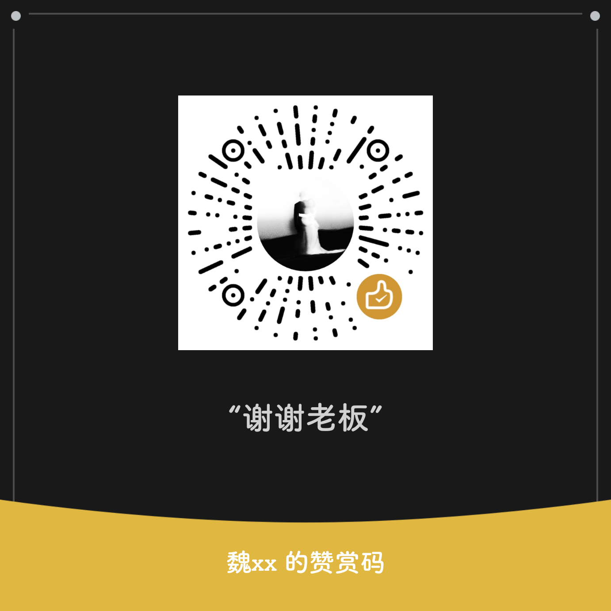

# FusionStatusBar 状态栏融合图标

FusionStatusBar 是面向 MIUI/HyperOS 的 LibXposed 模块，提供融合图标、双排状态栏、时钟天气与设备遥测、控制中心布局和外观编辑，以及桌面应用隐藏与手势。

[下载 0.5.27 正式 APK](https://github.com/Xposed-Modules-Repo/io.github.yudigaga.fusionstatusbar/releases/tag/241-0.5.27) · [主仓发布页](https://github.com/yudigaga/FusionStatusBar/releases/tag/v0.5.27) · [源码与反馈](https://github.com/yudigaga/FusionStatusBar) · [历史更新](HISTORY.md)

## 当前版本：0.5.27

版本号 `0.5.27`，构建号 `241`，沿用正式证书和 Release R8。以下为相对已发布 `0.5.25` 的累计更新：

- 新增“杂项 → 扫描与确认 → 隐藏首页风险提醒”，默认关闭，与“锁定 666 分”独立。开启后隐藏普通手机管家首页的危险/风险结论文案，病毒扫描、优化加速卡片使用普通颜色和中性说明，并隐藏红点。
- 补齐顶部和底部“正在体检…”的过滤，包括显入动画重新显示时的处理；底部实际结果文案保留。关闭开关时恢复原生显示，原生体检、扫描、优化和真实评分继续执行。
- 设置标题和说明覆盖七种界面语言。本版没有新增 LSPosed 作用域。

该扩展适配 `com.miui.securitycenter` 的 `13.8.0-261020.0.1`（versionCode `40001380`），其他版本不套用这组映射。顶部与体检文案适配普通 `MainContentFrame`，Lite、Pad、Fold 及结果页不在本次范围。

原始归档包含 **32 项相关 Release 测试**，失败、错误和跳过均为 `0`；lint 为 `0` 错误、`142` 条警告，高风险政策通过；R8 为 `8.13.19`。本版未重复全量测试，也未执行 Debug 构建。手机安装、R8 后真实 LSPosed 回调、ART 去优化、体检动画及目标 ROM 效果尚未实机验收。

[本版更新、签名与验证范围](https://github.com/yudigaga/FusionStatusBar/blob/v0.5.27/docs/release-notes-v0.5.27.md) · [首页提醒实现报告](https://github.com/yudigaga/FusionStatusBar/blob/v0.5.27/docs/2026-11-13_reverse-security-home-reminders-report.md) · [体检文案补充报告](https://github.com/yudigaga/FusionStatusBar/blob/v0.5.27/docs/2026-11-13_security-home-scanning-report.md)

## 功能

- 调整融合图标、状态栏布局和双排显示，选择充电时显示闪电或电量数字。
- 自定义时钟与天气，显示温度、功率电流和网络速度等信息。
- 编辑控制中心的布局、磁贴与外观，并提供预览和配置备份。
- 横屏自定义布局、分组成员图标缩放、统一容器材质与全局描边。
- 分别调整电源菜单、音量菜单、通知中心与悬浮通知外观，支持三条电源菜单和短款音量条。
- 隐藏桌面应用图标，自定义桌面手势与返回停顿，选择系统动作、应用、活动、快捷方式和功能切换。
- 设置页面、底部导航和公共弹窗使用 Compose/Miuix 控件。
- 应用界面支持跟随系统及简体中文、繁體中文、English、日本語、한국어、Русский、Español。
- 杂项页提供可选的链式启动确认移除、截屏剪贴板保护和指定版本的手机管家扩展，设置页可切换毛玻璃悬浮底栏。

## 适用范围

- Android 13（API 33）及以上，使用支持 LibXposed API 102 的框架。最低 Android 版本不代表所有厂商 ROM 均已验证兼容。
- 作用域为 `system`、`com.android.systemui`、`miui.systemui.plugin`、`com.miui.home` 和 `com.miui.securitycenter`。
- 侧边栏动作需要先开启系统侧边栏；“重启系统桌面”需要 root 授权。
- 手机管家扩展默认关闭，主要调整本地入口、支持判断或显示。超分、插帧、HDR、影院与充电等仍依赖原生服务和硬件；缺少杜比支持时开启影院可能导致手机管家崩溃。详见[功能边界](https://github.com/yudigaga/FusionStatusBar/blob/v0.5.27/docs/2026-11-09_security-center-13.8-report.md)。
- 高光玻璃尚未实现真实背景折射，也未完成目标 ROM 的真实 MiGlass 绘制、视觉和稳定性验收。

## 安装与启用

1. 从本仓库 Release 下载并安装正式 APK；沿用原证书，可覆盖更新 `0.5.25` 及 `0.5.26` 本地正式签名包。
2. 在 LSPosed 中启用模块，核对上述作用域。首次安装或从早期版本升级时补选 System（system / system_server），随后重启设备。
3. 使用本次首页功能时，开启“杂项 → 扫描与确认 → 隐藏首页风险提醒”，并在安装更新后重启手机管家进程，或重启设备加载新 Hook；仅重启 SystemUI 不会重启手机管家。
4. 已加载新 Hook 后，修改该开关会通知宿主刷新；可在当前首页核对开关恢复、增量/完整体检和实际结果显示。

首次加载系统侧截屏剪贴板保护同样需要 System 作用域及整机重启；后续修改开关按配置通知应用。语言切换只改变模块界面，无需重启 SystemUI 或手机管家。升级后原有图标、布局与语言设置保留，控制中心未推送草稿不会自动发布。

## 从旧包名迁移

从 `0.3.150` 起，应用包名为 `io.github.yudigaga.fusionstatusbar`。旧版 `com.xtjm.fusionstatusbar` 是另一应用，无法直接覆盖安装或自动继承配置。

1. 在旧版设置中选择“导出配置备份”。
2. 安装新版，在设置中选择“导入配置备份”。
3. 在 LSPosed 中关闭旧模块，只启用新版，再重启系统界面。确认新版正常后可卸载旧包。

不要同时启用新旧两个模块，以免两套 Hook 同时修改系统界面。

## 文档与反馈

- [0.5.25、0.5.24 与 0.3.173 历史更新](HISTORY.md)：保留原正文、下载地址、签名和验证记录。
- [主仓文档导航](https://github.com/yudigaga/FusionStatusBar/blob/v0.5.27/docs/README.md)：功能说明、构建方法和开发记录。
- [问题反馈](https://github.com/yudigaga/FusionStatusBar/issues)：请提供模块版本、ROM、宿主版本、作用域、复现步骤及脱敏日志。

## 赞助

如果你喜欢这个项目，欢迎请我喝杯咖啡 ☕

